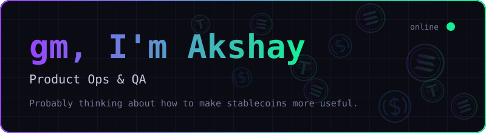

  

### 👨‍💻 What I do

**Product Ops and QA at a Web3 internet banking company.**

Making **stablecoins usable with credit cards, international banking rails and more**.

Scaling across **100K+ signups** and **$68M+ in volume**.

I make sure what ships works, and keep the product running smoothly for real users. **UAT, Design, Functionality and clean code**.

### 🛠️ Building on the side

Building personal finance tools, working on **optimising AI agents** and workflows.

### 🎮 Off the clock

Watching F1, playing basketball and trying out **new tech gadgets**.

---

### 🏛️ Prev

**Full Stack Developer, Capgemini** (Java, Angular) · 2 years

Worked on a **Mutual Funds platform for a global investment bank**, in a **Product Ops & Risk Tech** team.

---

### 💻 Languages

  <picture>
    <source media="(prefers-color-scheme: dark)" srcset="https://skillicons.dev/icons?i=py&theme=dark">
    
  </picture>
  <picture>
    <source media="(prefers-color-scheme: dark)" srcset="https://skillicons.dev/icons?i=java&theme=dark">
    
  </picture>
  <picture>
    <source media="(prefers-color-scheme: dark)" srcset="https://skillicons.dev/icons?i=ts&theme=dark">
    
  </picture>
  <picture>
    <source media="(prefers-color-scheme: dark)" srcset="https://skillicons.dev/icons?i=angular&theme=dark">
    
  </picture>
  <picture>
    <source media="(prefers-color-scheme: dark)" srcset="https://skillicons.dev/icons?i=rust&theme=dark">
    
  </picture>

### 🌐 Let’s Connect

  &nbsp;&nbsp;
  

